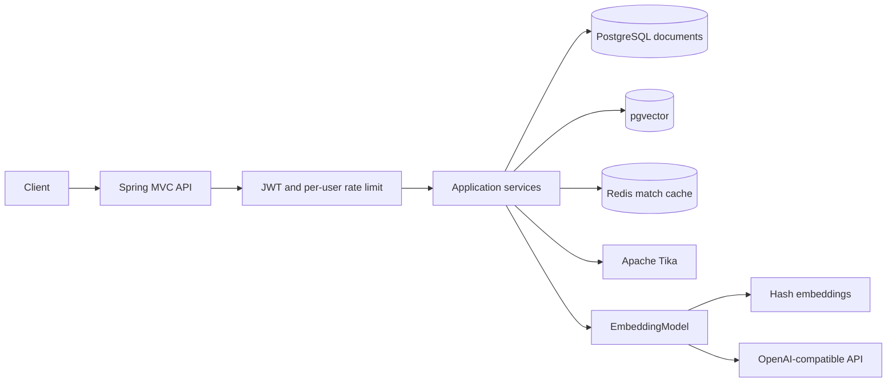

# AI Resume Job Matcher

Upload a resume and a job description, then ask how well they match. The service extracts text from PDF, DOCX, or plain text, splits it into chunks, and stores embeddings in PostgreSQL with pgvector. A match returns a score, the skills both sides share, the skills the job asks for that the resume does not show, and a short suggestion. You can also search the closest jobs for a resume, the closest resumes for a job, and ask a question that is answered from the indexed chunks.



## Tech stack

- Java 21 and Spring Boot 3.5
- Spring Security with stateless JWT (HS256)
- PostgreSQL 16, Flyway, and pgvector
- Spring AI vector store, with a local hash embedding model when no API key is set
- Redis cache for match results
- Bucket4j rate limiting per authenticated user
- Apache Tika for PDF, DOCX, and text
- Springdoc OpenAPI, Actuator, Micrometer tracing, and JSON console logs
- JUnit 5 and Testcontainers

## Key features

- Multipart upload of resumes and jobs. Parsing and indexing run after the pending row is committed. `GET /api/documents/{id}` reports `PENDING`, `READY`, or `FAILED`.
- A match returns a score and a skill gap. Both are computed without a language model.
- Semantic search returns the top 5 jobs for a resume, or the top 5 resumes for a job, scoped to the caller.
- Retrieval-augmented answers cite the chunk they came from. Without an API key the answer is the retrieved excerpt itself.
- Redis caches a resume/job match for 10 minutes. A repeat call does not recompute it.
- Each authenticated user gets 30 requests per minute. Registration and login are not limited.
- A demo account is created on startup: username `demo`, password `password`.

## Run locally

Docker Compose starts PostgreSQL with pgvector, Redis, Jaeger, and the application:

```bash
docker compose up --build
```

To run the application on the host instead, start only the dependencies and then the app. These ports are 5432, 6379, 8080, and 4318. Stop any other stack that already binds them.

```bash
docker compose up postgres redis jaeger
./mvnw spring-boot:run
```

On PowerShell use `.\mvnw.cmd spring-boot:run`.

- Swagger UI: http://localhost:8080/swagger-ui.html
- Health: http://localhost:8080/actuator/health
- Traces: http://localhost:16686

The default configuration starts with no API key. Embeddings are 128-dimensional hashes, and suggestions are written from the skill gap. To call an OpenAI-compatible server, set:

```bash
SPRING_AI_MODEL_CHAT=openai
SPRING_AI_MODEL_EMBEDDING=openai
OPENAI_API_KEY=your-key
OPENAI_BASE_URL=https://api.openai.com
APP_EMBEDDING_DIMENSIONS=1536
```

Changing the embedding width requires dropping the `vector_store` table so pgvector can recreate the column. `text-embedding-3-small` uses 1536 dimensions. The hash model uses 128. See `.env.example`. The checked-in JWT secret is for local development only. Set `JWT_SECRET` to at least 32 bytes anywhere else.

## API examples

Register and log in:

```bash
curl -s -X POST http://localhost:8080/api/auth/register \
  -H 'Content-Type: application/json' \
  -d '{"username":"ada","password":"password"}'

curl -s -X POST http://localhost:8080/api/auth/token \
  -H 'Content-Type: application/json' \
  -d '{"username":"demo","password":"password"}'
```

```json
{"accessToken":"<jwt>","tokenType":"Bearer","expiresInSeconds":43200}
```

Upload a resume. The same shape works for `POST /api/jobs`. Poll the status URL until it is `READY`.

```bash
curl -s -X POST http://localhost:8080/api/resumes \
  -H "Authorization: Bearer $TOKEN" \
  -F "file=@resume.txt;type=text/plain"
```

```json
{
  "id": "5d1c0c3e-6b1a-4f0e-9c2a-0b5a1d2e3f40",
  "owner": "demo",
  "kind": "RESUME",
  "filename": "resume.txt",
  "status": "PENDING",
  "createdAt": "2026-11-18T09:00:00Z"
}
```

An empty file ends as `FAILED` with `errorMessage` set to `No text could be extracted.`

Match a resume to a job:

```bash
curl -s -X POST http://localhost:8080/api/matches \
  -H "Authorization: Bearer $TOKEN" \
  -H 'Content-Type: application/json' \
  -d '{"resumeId":"<resume-uuid>","jobId":"<job-uuid>"}'
```

```json
{
  "resumeId": "5d1c0c3e-6b1a-4f0e-9c2a-0b5a1d2e3f40",
  "jobId": "8a2b1c4d-7e6f-4a90-8b12-33c4d5e6f708",
  "score": 0.74,
  "matchedSkills": ["java", "kafka", "spring", "spring boot"],
  "missingSkills": ["aws", "kubernetes"],
  "suggestions": "Add a short example for each missing skill: aws, kubernetes.",
  "suggestionSource": "fallback"
}
```

`suggestionSource` is `openai` when a chat model is configured and the call succeeds.

Search and ask:

```bash
curl -s "http://localhost:8080/api/resumes/<resume-uuid>/jobs?limit=5" \
  -H "Authorization: Bearer $TOKEN"

curl -s -X POST http://localhost:8080/api/ask \
  -H "Authorization: Bearer $TOKEN" \
  -H 'Content-Type: application/json' \
  -d '{"documentId":"<resume-uuid>","question":"Does this candidate know Kafka?"}'
```

```json
{
  "answer": "A language model is not configured. Closest indexed excerpts: [chunk 0] Java developer. Spring Boot microservices, Kafka, PostgreSQL.",
  "citations": [{"chunk": "0", "excerpt": "Java developer. Spring Boot microservices, Kafka, PostgreSQL."}],
  "source": "fallback"
}
```

Missing or invalid tokens return `application/problem+json` with status 401. A second registration of the same username returns 409. Calls after the per-user limit return 429. A document owned by someone else is a 404.

## Design decisions

- The embedding port is Spring AI's `EmbeddingModel`. The default implementation hashes tokens into 128 buckets and L2-normalizes the vector. That is a lexical fingerprint, not a semantic model. It keeps `docker compose up` and CI working with no secret, and it exercises the same pgvector path a hosted embedding model would use. Switching to OpenAI is an environment change plus a table rebuild, because the vector column width is fixed at creation.
- Match score is `0.6 * cosine + 0.4 * (matched job skills / job skills)`. If the job names none of the known skills, the score is the cosine alone. The dictionary is intentionally small and explicit so the gap is explainable. Word boundaries stop `javascript` from counting as `java`.
- Chunks live in `vector_store`, which Spring AI creates after Flyway installs the `vector` extension. The application tables hold the owner, status, and full text. Search filters use the Spring AI filter builder so the JWT subject is a bound value, not a concatenated string. Results are grouped by document and ranked by the best chunk score.
- Match results are cached in Redis under `owner:resumeId:jobId`. The cache sits on the public service method the controller calls. Upload processing is `@Async` on a different bean, and it starts only after the pending insert commits.
- Rate limits use an in-memory Bucket4j bucket per JWT subject. That is simple and correct for one instance. It does not coordinate across replicas. Login is excluded so a test or a script can still obtain a token after the bucket is empty.
- JWT is a local HS256 token. The resource server validates it. This service does not delegate to an identity provider. Passwords are bcrypt hashes. The demo user is inserted at startup only when that username is absent.
- Chat uses Spring AI when `SPRING_AI_MODEL_CHAT=openai`. The key and base URL come from the environment. If the property is `none`, or the call fails, the service returns the deterministic suggestion or the retrieved excerpts and says so in `suggestionSource` or `source`.
- Logs are structured JSON. Traces export over OTLP to Jaeger when the collector is up. Actuator exposes health, metrics, and Prometheus.

## Testing

Unit tests cover chunk overlap, the skill dictionary, hash-embedding neighborhood, the score formula, suggestion text, filename cleanup, and Tika plain-text extraction. They do not need Docker.

`MatcherIntegrationTest` starts pgvector and Redis with Testcontainers. It registers a user, uploads a resume and two jobs, waits until indexing finishes, checks the match and the Redis cache, checks both search directions, asks a question, checks that another user cannot read the document, checks an empty upload, checks 401 and 409, and checks the 429 limit with a separate user so the other tests do not share a bucket.

```bash
./mvnw verify
```

GitHub Actions runs that command on every push and pull request. Docker must be available, because the integration test uses Testcontainers.

## Possible next steps

- Average the chunk vectors when a document is too long for a hosted embedding model.
- Add a cross-encoder reranker in front of the top matches.
- Store Bucket4j buckets in Redis so the limit holds across instances.
- OCR scanned PDFs, and let a user replace a document without leaving orphan vectors.
- Move identity to an external authorization server if this API sits behind a gateway.
